[README.md](https://github.com/user-attachments/files/34983198/README.md)# 📚 Kompendium Dobrych Praktyk UX & Dostępności Cyfrowej (WCAG 2.2)

> **Profesjonalna Baza Wiedzy, Wytycznych Projektowych i Matryca Audytowa UX/UI**  
> Oparta o standardy W3C (WCAG 2.2), badania Nielsen Norman Group (NN/g), Baymard Institute, ISO 9241 oraz współczesne wytyczne Design Systemów (Google Material Design 3, Apple HIG).

---

## 🗺️ Mapa Wiedzy (Knowledge Map)

Poniższa mapa przedstawia strukturę bazy wiedzy oraz wzajemne relacje pomiędzy obszarami projektowania doświadczeń użytkownika:

```mermaid
graph TD
    Root["🏛️ UX & Accessibility Knowledge Base"] --> IA["1. Architektura & Nawigacja"]
    Root --> A11Y["2. Dostępność Cyfrowa (WCAG 2.2)"]
    Root --> TYPO["3. Typografia & Hierarchia Wizualna"]
    Root --> FORM["4. Formularze & Interakcje"]
    Root --> MOB["5. Mobile & Touch UX"]
    Root --> PERF["6. Performance & Web Vitals"]
    Root --> ERR["7. Obsługa Błędów & Feedback"]
    Root --> ETH["8. Etyka, Zaufanie & Dark Patterns"]

    IA --> IA_Hick["Prawo Hicka & Millera"]
    IA --> IA_Nav["Wzorce Nawigacji & Wyszukiwarki"]
    
    A11Y --> A11Y_POUR["Zasady POUR (WCAG 2.2 AA)"]
    A11Y --> A11Y_Focus["Focus Visible & Target Size 24px"]
    
    TYPO --> TYPO_Gestalt["Zasady Gestalt & Skanowanie F/Z"]
    TYPO --> TYPO_Scale["Modular Scale & Line Measure (50-75ch)"]
    
    FORM --> FORM_Inline["Inline Validation & Prawo Fittsa"]
    FORM --> FORM_Labels["Top-Aligned Labels & Autocomplete"]
    
    MOB --> MOB_Thumb["Thumb Zone & Touch Target (min 44px)"]
    
    PERF --> PERF_CWV["LCP, INP, CLS & Skeleton Screens"]
    
    ERR --> ERR_Heuristics["Heurystyki Nielsena #5 i #9"]
    
    ETH --> ETH_Dark["Deceptive Patterns & Zgodność z Dyrektywą Omnibus"]

    Root --> MATRIX["📋 Kompletna Matryca Checkilist & Scoring"]
    Root --> AUDIT["🔍 Praktyczny Audyt: Persona & User Journey"]
    Root --> SKILL["🤖 Autorski Skill AI dla Agentów (/ux-auditor)"]
```



---

## 📂 Struktura Repozytorium

```text
ux-knowledge-base/
├── README.md                           # Ten plik: mapa wiedzy, nawigacja i metodologia
├── teams-post-template.md              # Gotowy draft posta ogłoszeniowego na MS Teams
├── docs/                               # Szczegółowe wytyczne podzielone na aspekty
│   ├── 01-architektura-i-nawigacja.md   # IA, menu, breadcrumbs, faceted search, prawa UX
│   ├── 02-dostepnosc-wcag22.md          # POUR, kryteria sukcesu WCAG 2.2 AA/AAA, ARIA
│   ├── 03-typografia-i-hierarchia.md    # Skale typograficzne, czytelność, zasady Gestalt
│   ├── 04-formularze-i-interakcje.md    # Układy pól, walidacja on-blur, prawo Fittsa
│   ├── 05-mobile-i-responsywnosc.md     # Thumb zone, rozmiary touch targets, responsywność
│   ├── 06-wydajnosc-i-web-vitals.md     # Core Web Vitals (LCP, INP, CLS), perceived performance
│   ├── 07-bledy-i-obsluga-wyjatkow.md   # Heurystyki #5 i #9, komunikaty błędów, recovery
│   ├── 08-zaufanie-i-dark-patterns.md   # Deceptive design, transparentność, prawo UE/Omnibus
│   └── checklist-kompletna.md          # 50-punktowa ustrukturyzowana checklista z wagami
├── audit/                              # Kompleksowe studium przypadku audytu UX
│   ├── persona-teresa.md               # Pogłębiony profil persony (ograniczenia, cele)
│   ├── user-journey-map.md             # Ścieżka zakupu: 5 kluczowych ekranów
│   ├── screens/                        # Wysokiej rozdzielczości makiety ekranów z anotacjami
│   │   ├── screen-1-home.svg
│   │   ├── screen-2-search-results.svg
│   │   ├── screen-3-product-card.svg
│   │   ├── screen-4-cart.svg
│   │   └── screen-5-checkout.svg
│   └── visual-audit-report.md          # Pełen raport audytu: błędy, wagi, makiety i fixy
└── skills/
    └── ux-auditor/                     # Autorski Skill dla agentów AI do natychmiastowego audytu
        ├── SKILL.md                    # Definicja umiejętności, prompt systemowy i reguły
        └── scripts/
            └── audit_engine.py         # Narzędzie CLI do zautomatyzowanej ewaluacji
```

---

## 🧭 Instrukcja Poruszania się po Bazie Wiedzy

W zależności od Twojej roli w zespole produktowym, zalecamy następujące ścieżki lektury:

### 1. Dla UI/UX Designerów & Product Designerów
* Zacznij od modułów:
  * [03. Typografia & Hierarchia Wizualna](docs/03-typografia-i-hierarchia.md)
  * [04. Formularze & Interakcje](docs/04-formularze-i-interakcje.md)
  * [05. Mobile & Touch UX](docs/05-mobile-i-responsywnosc.md)
* Korzystaj z [Kompletnej Checklisty](docs/checklist-kompletna.md) podczas przygotowywania makiet w Figmie przed przekazaniem do deweloperów.

### 2. Dla Frontend / Fullstack Developerów
* Skup się na implementacji technicznej:
  * [02. Dostępność Cyfrowa WCAG 2.2](docs/02-dostepnosc-wcag22.md) (semantyka HTML5, role ARIA, `focus-visible`, target size 24x24px)
  * [06. Wydajność & Web Vitals](docs/06-wydajnosc-i-web-vitals.md) (optymalizacja LCP, INP, CLS, skeletony)
  * [07. Obsługa Błędów](docs/07-bledy-i-obsluga-wyjatkow.md) (walidacja on-blur, zachowanie stanu formularza)

### 3. Dla QA Testerów & Audytorów
* Wykorzystaj [Kompletną Checklistę](docs/checklist-kompletna.md) jako kryteria akceptacyjne w testach regresyjnych i manualnych.
* Przejrzyj przykładowy [Raport z Audytu](audit/visual-audit-report.md), aby poznać standard raportowania błędów z macierzą wag.

### 4. Dla Product Ownerów / Managerów
* Zapoznaj się z [08. Etyka, Zaufanie & Dark Patterns](docs/08-zaufanie-i-dark-patterns.md), aby upewnić się, że produkt spełnia regulacje prawne UE (Dyrektywa Omnibus, DSA) i buduje długofalowy LTV.

---

## ⚖️ Matryca Klasyfikacji Wag Błędów (Severity Matrix)

Do kategoryzacji usterek i barier ergonomicznych stosujemy matrycę uwzględniającą **Wpływ na użytkownika (Impact)** oraz **Częstotliwość występowania (Frequency)**:

| Waga błędu | Definicja | Kryterium WCAG / UX | SLA / Czas naprawy |
| :--- | :--- | :--- | :--- |
| 🔴 **BLOCKER (Krytyczny)** | Całkowicie uniemożliwia użytkownikowi ukończenie kluczowego zadania (np. brak możliwości przejścia do kasy, uwięzienie fokusa klawiatury). | Naruszenie WCAG Level A; Heurystyka #5 | Natychmiast (Hotfix przed wdrożeniem) |
| 🟠 **CRITICAL (Poważny)** | Poważne utrudnienie; wymaga skomplikowanego obejścia problemu lub wywołuje dezorientację u znacznej grupy użytkowników. | Naruszenie WCAG Level AA; Heurystyka #1, #9 | Następny sprint (P0/P1) |
| 🟡 **MAJOR (Średni)** | Usterka pogarszająca komfort obsługi lub spowalniająca realizację celu, ale zadanie można wykonać. | Rekomendacje WCAG AAA; Dobre praktyki UX | W planie kwartalnym (P2) |
| 🟢 **MINOR (Niski/Kosmetyczny)** | Drobne nieścisłości wizualne, odstępstwa od siatki, literówki niemające wpływu na zrozumienie interfejsu. | Estetyka UI; Spójność microcopy | Przy okazji prac nad widokiem (P3) |

---

## 🛠️ Autorski Skill AI (`ux-auditor`)

W repozytorium znajduje się gotowy do użycia skill dla agentów AI zintegrowany z Antigravity:
* Lokalizacja: `skills/ux-auditor/`
* Umożliwia przeprowadzenie kompleksowego audytu dowolnego adresu URL, zrzutu ekranu lub kodu HTML jedną komendą:
  ```bash
  /ux-audit url="https://twoja-strona.pl"
  ```
* Pełna dokumentacja i instrukcja instalacji w [skills/ux-auditor/SKILL.md](skills/ux-auditor/SKILL.md).

# ux-knowledge-base
