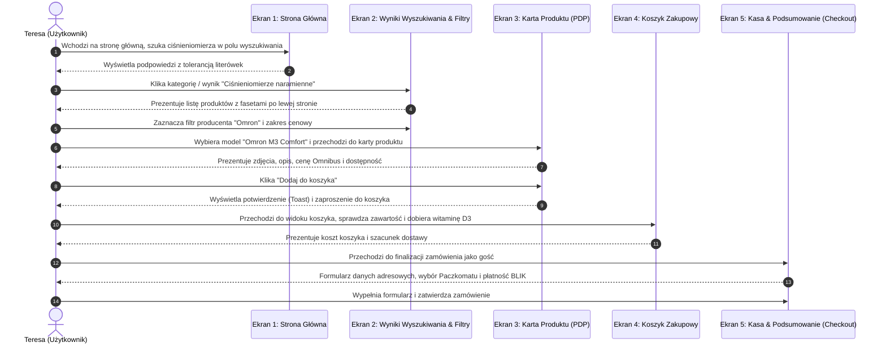

# Mapa Podróży Użytkownika (User Journey Map)

> **Persona:** Teresa Wiśniewska (61 lat)  
> **Kontekst:** Zakup ciśnieniomierza medycznego i witaminy D3 na portalu *ZdrowiePlus.pl*  
> **Zakres:** 5 kluczowych ekranów procesu e-commerce

---

## 🗺️ Przebieg Ścieżki Zakupowej (5 Ekranów)

---

## 🔍 Szczegółowy Rozkład Kroków i Punktów Styku (Touchpoints)

### Krok 1: Wejście i Wyszukiwanie (Ekran 1: Strona Główna)
* **Cel Teresy:** Szybko odnaleźć sekcję ciśnieniomierzy bez błądzenia po promocjach kosmetycznych.
* **Akcja:** Spojrzenie na nagłówek, próba wpisania frazy "cisnieniomiez naramienny" w wyszukiwarkę na górze strony.
* **Oczekiwany stan UX:** Wyszukiwarka z wyraźnym kontrastem, podpowiedzi w czasie rzeczywistym z tolerancją na brak polskich znaków i literówki.

### Krok 2: Eksploracja i Dobór Parametrów (Ekran 2: Wyniki Wyszukiwania & Filtrowanie)
* **Cel Teresy:** Ograniczenie listy 48 produktów do tych, które są naramienne i rekomendowane dla seniorów.
* **Akcja:** Zaznaczenie checkboxów: "Typ: Naramienny" oraz "Producent: Omron".
* **Oczekiwany stan UX:** Filtry o dużych celach dotykowych (min. 24x24px), dynamiczne zawężenie listy bez konieczności ponownego przewijania na sam dół, widoczne żetony (chips) aktywnych filtrów.

### Krok 3: Weryfikacja Szczegółów i Wybór (Ekran 3: Karta Produktu)
* **Cel Teresy:** Upewnienie się, czy zasilacz sieciowy jest w pudełku oraz sprawdzenie gwarancji i ceny.
* **Akcja:** Przegląd galerii zdjęć, odczytanie specyfikacji technicznej, sprawdzenie zgodności z Dyrektywą Omnibus, kliknięcie "Dodaj do koszyka".
* **Oczekiwany stan UX:** Duży kontrast tekstu (min. 4.5:1), wyraźna cena z informacją o najniższej cenie z 30 dni, widoczny i kontrastowy przycisk CTA w strefie kciuka/zasięgu wzroku.

### Krok 4: Weryfikacja Koszyka i Cross-sell (Ekran 4: Koszyk)
* **Cel Teresy:** Sprawdzenie sumy zamówienia, upewnienie się, że nie doliczono żadnych niechcianych usług.
* **Akcja:** Dobranie witaminy D3 z rekomendacji koszykowych, weryfikacja czy koszyk nie zawiera ukrytych opłat za ubezpieczenie.
* **Oczekiwany stan UX:** Brak automatycznie zaznaczonych płatnych checkboxów (zakaz Sneak-in), możliwość bezproblemowej zmiany ilości sztuk, transparentna kwota dostawy.

### Krok 5: Zamówienie i Płatność (Ekran 5: Kasa i Podsumowanie)
* **Cel Teresy:** Wprowadzenie danych do wysyłki jako gość, wybór automatu Paczkomat i opłacenie BLIK-iem bez konieczności zakładania konta z hasłem.
* **Akcja:** Wypełnienie pól imię, nazwisko, telefon, e-mail, adres, zaznaczenie wymaganych regulaminów i kliknięcie "Kupuję i płacę".
* **Oczekiwany stan UX:** Jednokolumnowy formularz, etykiety trwale nad polami, inline walidacja on-blur, brak kasowania wpisanych danych przy pomyłce, wyraźne podsumowanie kosztu całkowitego przed kliknięciem.
