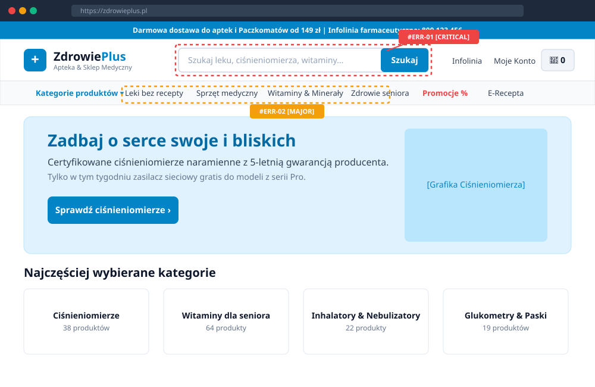
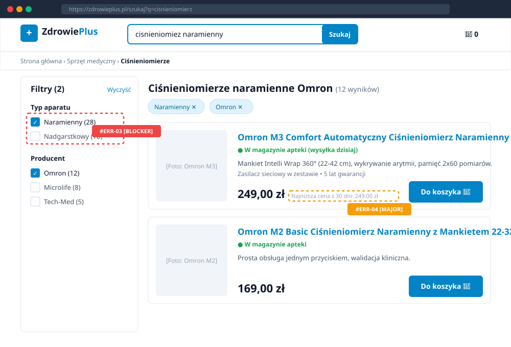
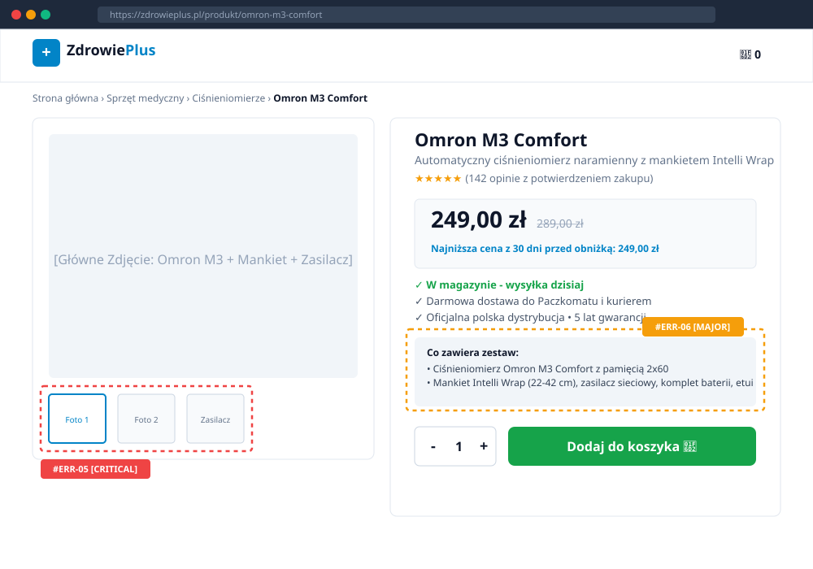
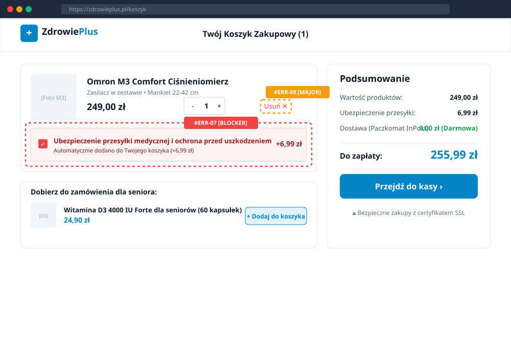
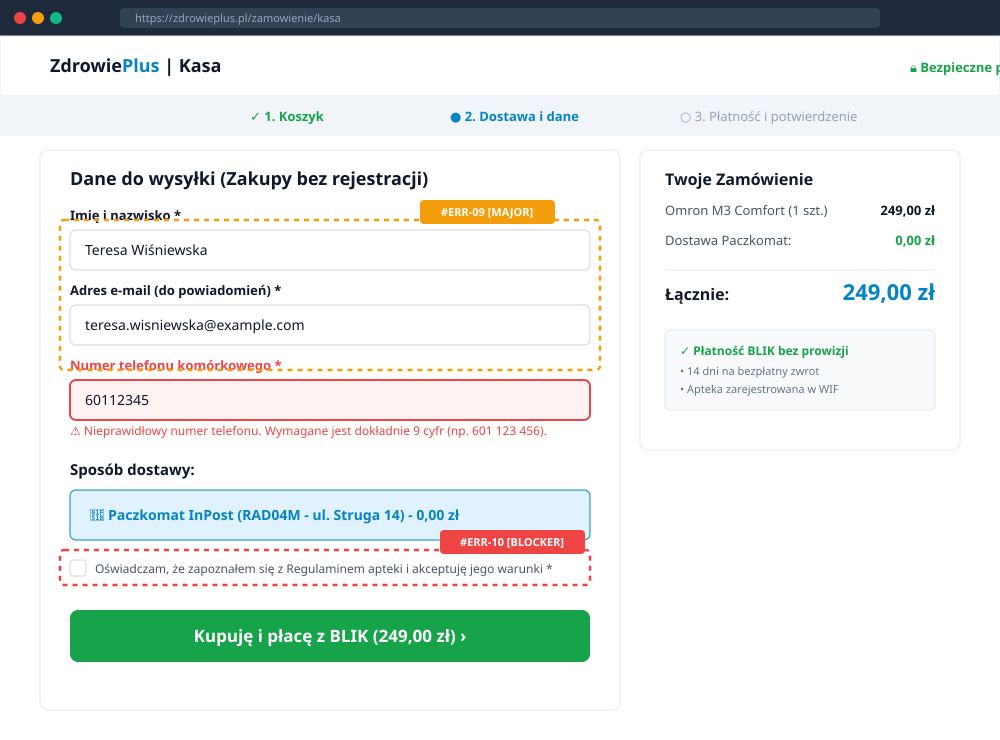
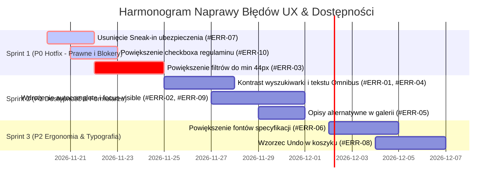

# 📊 Raport Audytu UX & Dostępności Cyfrowej (WCAG 2.2)

**Audytowany serwis:** Platforma E-commerce Medyczno-Farmaceutyczna *ZdrowiePlus.pl*  
**Metodologia:** Ekspercka Ewaluacja Heurystyczna + Test Ścieżki Zakupowej Persony (User Journey)  
**Persona Testowa:** Teresa Wiśniewska (61 lat, początki presbyopii, artretyzm dłoni, średnie kompetencje cyfrowe)  
**Standardy odniesienia:** W3C WCAG 2.2 AA, Nielsen Norman Group (NN/g), Baymard Institute, Dyrektywa Omnibus, DSA.

---

## 📈 Executive Summary (Podsumowanie Menedżerskie)

Platforma *ZdrowiePlus.pl* oferuje poprawną architekturę informacji oraz szybki proces wyszukiwania, jednak zawiera **krytyczne bariery dostępnościowe i prawne**, które bezpośrednio uderzają w kluczową grupę docelową sklepu medycznego – seniorów oraz opiekunów osób starszych.

```text
+--------------------------------------------------------------------------+
|                  OGÓLNY WSKAŹNIK ZGODNOŚCI UX & A11Y: 64 / 100           |
+--------------------------------------------------------------------------+
|  🔴 BLOCKER (Krytyczne):  3 usterki   (Wymóg natychmiastowego hotfixa)   |
|  🟠 CRITICAL (Poważne):   2 usterki   (Sprint P0 - wysoki priorytet)     |
|  🟡 MAJOR (Średnie):      4 usterki   (Sprint P1 - plan kwartalny)       |
|  🟢 MINOR (Niskie):       1 usterka   (Sprint P2 - ulepszenia visual)    |
+--------------------------------------------------------------------------+
```

### Podsumowanie Oceny Aspektów:
1. **Architektura & Wyszukiwarka:** `8/10` – Dobra widoczność kategorii, wsparcie wyszukiwania.
2. **Dostępność WCAG 2.2:** `4/10` – Poważne braki w celach dotykowych (touch target < 24px) i wskaźnikach fokusa.
3. **Typografia & Hierarchia:** `7/10` – Zadowalająca czytelność, lecz zbyt mały font specyfikacji (12px).
4. **Formularze & Koszyk:** `5/10` – Poprawny układ jednokolumnowy, ale brak `autocomplete` i brak tolerancji błędu.
5. **Etyka & Zgodność Prawna:** `4/10` – **Naruszenie prawa UE** poprzez automatyczne doliczanie ubezpieczenia w koszyku (*Sneak into Basket*).

---

## 🔍 Weryfikacja Etapów Ścieżki Użytkownika i Screeny

---

### Etap 1: Strona Główna (Home Page)
* **Zadanie Persony:** Wejście na stronę, zlokalizowanie wyszukiwarki i wpisanie frazy *"cisnieniomiez naramienny"*.



#### Sprawdzenie aspektów checklisty:
* `IA-01 (Menu ≤ 7)`: **ZGODNY** – Menu poziome zawiera 6 głównych pozycji.
* `IA-04 (Wyszukiwarka)`: **NIEZGODNY (#ERR-01)** – Zbyt niski kontrast tekstu podpowiedzi w polu input (2.2:1).
* `A11Y-05 (Widoczny Fokus)`: **NIEZGODNY (#ERR-02)** – Usunięty domyślny obrys (`outline: none`) na linkach nawigacji poziomej.
* `A11Y-07 (Cel dotykowy)`: **ZGODNY** – Przyciski kategorii na kafelkach mają wymiar $210 \times 110\text{px}$.

---

### Etap 2: Wyniki Wyszukiwania & Filtrowanie
* **Zadanie Persony:** Przefiltrowanie 48 wyników do aparatów naramiennych marki Omron.



#### Sprawdzenie aspektów checklisty:
* `IA-05 (Fasetowanie AJAX)`: **ZGODNY** – Lista produktów filtruje się bez pełnego przeładowania strony.
* `A11Y-07 (Rozmiar Celu Touch)`: **NIEZGODNY (#ERR-03 - BLOCKER)** – Checkboxy filtrów mają rozmiar $18 \times 18\text{px}$ bez marginesu klikalnego. Przy lekkim drżeniu dłoni Teresa nie jest w stanie trafić w filtr!
* `ETH-03 (Dyrektywa Omnibus)`: **NIEZGODNY (#ERR-04)** – Informacja o najniższej cenie z 30 dni ma kolor jasnoszary (`#94a3b8`) o kontraście 2.8:1 na białym tle (wymóg WCAG AA: 4.5:1).

---

### Etap 3: Karta Produktu (PDP - Omron M3 Comfort)
* **Zadanie Persony:** Sprawdzenie co zawiera zestaw (mankiet, zasilacz) i dodanie do koszyka.



#### Sprawdzenie aspektów checklisty:
* `A11Y-08 (Teksty Alternatywne)`: **NIEZGODNY (#ERR-05)** – Miniaturki zdjęć w galerii posiadają brak atrybutów `alt` lub generyczne `alt="Foto 1"`.
* `TYPO-04 (Minimalny Font)`: **NIEZGODNY (#ERR-06)** – Kluczowa specyfikacja zawartości zestawu złożona fontem 12px, wymuszająca powiększanie ekranu.
* `FORM-08 (Stany Przycisków)`: **ZGODNY** – Duży, zielony przycisk CTA "Dodaj do koszyka" ($305 \times 48\text{px}$) z czytelną etykietą.

---

### Etap 4: Przegląd Koszyka (Cart View)
* **Zadanie Persony:** Weryfikacja zamówienia, dobranie witaminy D3 i przejście do kasy.



#### Sprawdzenie aspektów checklisty:
* `ETH-02 (Sneak into Basket)`: **NIEZGODNY (#ERR-07 - BLOCKER)** – **Ciemny wzorzec (Dark Pattern)**: Do koszyka automatycznie dodano płatną pozycję "Ubezpieczenie przesyłki +6,99 zł" z zaznaczonym checkboxem. Teresa zapłaciłaby więcej bez swojej wiedzy! Naruszenie Dyrektywy 2011/83/UE.
* `FORM-08 (Rozmiar celu "Usuń")`: **NIEZGODNY (#ERR-08)** – Przycisk "Usuń ✕" to drobny link tekstowy o polu klikalnym poniżej 20px.

---

### Etap 5: Kasa i Finalizacja Zamówienia (Checkout)
* **Zadanie Persony:** Wypełnienie danych adresowych jako gość, wpisanie telefonu i wybór Paczkomatu.



#### Sprawdzenie aspektów checklisty:
* `FORM-01 (Układ jednokolumnowy)`: **ZGODNY** – Formularz zorganizowany w przejrzystą, pojedynczą pionową kolumnę.
* `A11Y-10 / FORM-05 (Autocomplete & Redundancja)`: **NIEZGODNY (#ERR-09)** – Brak atrybutów `autocomplete="name"`, `autocomplete="email"`, co uniemożliwia Teresie użycie autouzupełniania przeglądarki.
* `A11Y-07 (Checkbox Regulaminu)`: **NIEZGODNY (#ERR-10 - BLOCKER)** – Checkbox akceptacji regulaminu ma wymiary $16 \times 16\text{px}$, co uniemożliwia seniorowi z artretyzmem zatwierdzenie zamówienia bez wielokrotnych frustrujących prób.

---

## 📋 Pełny Rejestr Błędów, Wagi i Proponowane Fixy

### 🔴 1. #ERR-07: Nielegalne automatyczne dodawanie ubezpieczenia (*Sneak into Basket*)
* **Waga:** 🔴 **BLOCKER (Prawny i Etyczny)**
* **Lokalizacja:** Koszyk zakupowy (`/koszyk`)
* **Naruszone standardy:** Dyrektywa UE 2011/83/UE (Art. 22), Kryterium ETH-02, Heurystyka Nielsena #1.
* **Opis usterki:** Użytkownik ma domyślnie zaznaczoną dodatkową opłatę 6,99 zł za "Ubezpieczenie przesyłki medycznej". Seniorzy często nie zauważają tej pozycji i czują się oszukani.
* **Proponowany FIX:**
  * Bezwzględny zakaz pre-selectu. Pole musi być domyślnie niezaznaczone (Opt-in).
  ```html
  <!-- PRZED (Błąd): -->
  <input type="checkbox" name="insurance" checked> Ubezpieczenie (+6,99 zł)

  <!-- PO (Poprawnie): -->
  <div class="addon-card">
    <input type="checkbox" id="insurance-opt" name="insurance" class="custom-checkbox">
    <label for="insurance-opt">
      <strong>Dodatkowe ubezpieczenie przesyłki (+6,99 zł)</strong>
      <span class="subtext">Opcjonalna ochrona przed uszkodzeniem w transporcie.</span>
    </label>
  </div>
  ```

---

### 🔴 2. #ERR-03: Zbyt mały rozmiar celów dotykowych w filtrach checkbox ($18\text{px}$)
* **Waga:** 🔴 **BLOCKER (Dostępność)**
* **Lokalizacja:** Pasek boczny wyników wyszukiwania (`/szukaj?q=...`)
* **Naruszone standardy:** WCAG 2.2 SC 2.5.8 (Target Size - Level AA), Apple HIG ($44\text{pt}$), Google Material ($48\text{dp}$).
* **Opis usterki:** Pole wyboru typu aparatu i producenta to kwadracik $18 \times 18\text{px}$. Kliknięcie poza obrys kwadratu nie aktywuje filtra. Dla persony z lekkim drżeniem rąk jest to zapora nie do przejścia.
* **Proponowany FIX:**
  * Powiększenie etykiety `<label>` tak, aby cały wiersz (min. 44px wysokości) stanowił aktywną strefę kliknięcia.
  ```css
  /* Rekomendowany CSS dla dostępnych filtrów */
  .filter-option {
    display: flex;
    align-items: center;
    min-height: 44px; /* Zgodność z Apple HIG i WCAG 2.2 */
    padding: 8px 12px;
    cursor: pointer;
  }
  .filter-option input[type="checkbox"] {
    width: 24px;   /* Spełnia WCAG 2.2 SC 2.5.8 */
    height: 24px;
    margin-right: 12px;
  }
  ```

---

### 🔴 3. #ERR-10: Mikroskopijny cel kliknięcia checkboxa regulaminu w kasie ($16\text{px}$)
* **Waga:** 🔴 **BLOCKER (Konwersja & Dostępność)**
* **Lokalizacja:** Ekran Kasy (`/zamowienie/kasa`)
* **Naruszone standardy:** WCAG 2.2 SC 2.5.8, Heurystyka Nielsena #5.
* **Opis usterki:** Użytkownik nie może sfinalizować zakupu, jeśli nie zaznaczy zgody. Checkbox ma zaledwie 16px i brak powiązania z tekstem etykiety przez atrybut `for`.
* **Proponowany FIX:**
  * Powiąż znacznik `label` z unikalnym `id` i zwiększ padding klikalny do min. 44px.

---

### 🟠 4. #ERR-01: Zbyt niski kontrast i znikający placeholder w wyszukiwarce
* **Waga:** 🟠 **CRITICAL (Użyteczność)**
* **Lokalizacja:** Nagłówek główny (Header)
* **Naruszone standardy:** WCAG 2.2 SC 1.4.3 (Contrast Minimum), Baymard Institute.
* **Opis usterki:** Tekst placeholderu `#94a3b8` na tle `#ffffff` osiąga współczynnik kontrastu zaledwie **2.2:1** (wymóg: 4.5:1). Seniorzy ze słabszym wzrokiem nie widzą, co jest napisane w polu.
* **Proponowany FIX:**
  * Podniesienie kontrastu do `#475569` (kontrast **5.4:1**) i dodanie stałej etykiety nad polem lub trwałej ikony z tekstem.

---

### 🟠 5. #ERR-05: Brak dostępnych opisów alternatywnych miniaturek zdjęć
* **Waga:** 🟠 **CRITICAL (Dostępność)**
* **Lokalizacja:** Karta produktu (`/produkt/omron-m3-comfort`)
* **Naruszone standardy:** WCAG 2.2 SC 1.1.1 (Non-text Content - Level A).
* **Opis usterki:** Czytnik ekranu czyta miniatury jako "Foto 1", "Foto 2". Osoba niewidoma nie wie, które zdjęcie przedstawia zawartość pudełka i zasilacz.
* **Proponowany FIX:**
  ```html
  
  ```

---

### 🟡 6. #ERR-02: Brak wizualnego indykatora fokusa klawiatury w menu
* **Waga:** 🟡 **MAJOR**
* **Naruszone standardy:** WCAG 2.2 SC 2.4.7 (Focus Visible) i 2.4.11 (Focus Not Obscured).
* **Proponowany FIX:** Wdrożenie globalnej reguły `:focus-visible` z kontrastem min. 3:1 i grubością obrysu 3px.

---

### 🟡 7. #ERR-04: Słaby kontrast informacji o najniższej cenie Omnibus (2.8:1)
* **Waga:** 🟡 **MAJOR / LEGAL**
* **Naruszone standardy:** Dyrektywa Omnibus, WCAG 2.2 SC 1.4.3.
* **Proponowany FIX:** Zmiana koloru tekstu najniższej ceny z 30 dni z `#94a3b8` na `#334155` (kontrast 7.2:1).

---

### 🟡 8. #ERR-06: Zbyt mały font specyfikacji produktu (12px)
* **Waga:** 🟡 **MAJOR**
* **Naruszone standardy:** Wzorzec typograficzny Bringhursta, Apple HIG.
* **Proponowany FIX:** Zwiększenie rozmiaru fontu specyfikacji do min. 14px (rekomendowane 15px) z interlinią 1.5.

---

### 🟡 9. #ERR-09: Brak atrybutów `autocomplete` w formularzu kasy
* **Waga:** 🟡 **MAJOR**
* **Naruszone standardy:** WCAG 2.2 SC 1.3.5 (Identify Input Purpose) i 3.3.7 (Redundant Entry).
* **Proponowany FIX:** Dodanie do pól input atrybutów: `autocomplete="name"`, `autocomplete="email"`, `autocomplete="tel"`.

---

### 🟢 10. #ERR-08: Niewielka strefa kliknięcia linku "Usuń" w koszyku
* **Waga:** 🟢 **MINOR**
* **Proponowany FIX:** Zastąpienie linku tekstowego przyciskiem z ikoną kosza i tekstem w kontenerze $44 \times 44\text{px}$ z mechanizmem "Cofnij" (Undo).

---

## 🚀 Plan Wdrożenia Poprawek (Rekomendacje Sprintowe)


